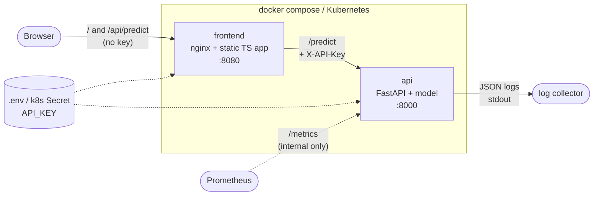

# predictive-maintenance-service

Machine failure prediction service based on the
[AI4I 2020 Predictive Maintenance](https://archive.ics.uci.edu/dataset/601/ai4i+2020+predictive+maintenance+dataset)
dataset: a scikit-learn model served by a FastAPI API, with a small TypeScript console,
Docker, CI on GitHub Actions and Kubernetes manifests.

## Architecture



Details and design choices: [docs/ARCHITECTURE.md](docs/ARCHITECTURE.md).

## Repository layout

| Path | Content |
|---|---|
| `src/pm_service/` | preprocessing, model loading, config, logging, metrics, API |
| `scripts/` | `train.py`, `export_holdout.py`, `run_e2e.py` |
| `models/` | versioned model (`model.joblib`) and its `metadata.json` |
| `tests/` | unit, API, quality gate; `tests/e2e/` against the running stack |
| `frontend/` | Vite + TypeScript console, nginx config, Dockerfile |
| `k8s/` | Kubernetes manifests |
| `.github/workflows/ci.yml` | CI pipeline |
| `docs/` | architecture, monitoring, Kubernetes, AI usage log, problems, production gaps |

## Quick start (Docker)

```powershell
Copy-Item .env.example .env      # then set a real API_KEY
docker compose up --build
```

- Console: http://localhost:8080
- API docs: http://localhost:8000/docs

```bash
curl -X POST http://localhost:8000/predict \
  -H "X-API-Key: <your API_KEY>" \
  -H "Content-Type: application/json" \
  -d '{"type":"L","air_temperature_k":302.5,"process_temperature_k":311.0,"rotational_speed_rpm":1250,"torque_nm":72.0,"tool_wear_min":230}'
```

## Local development

```powershell
python -m venv .venv
.venv\Scripts\Activate.ps1
pip install -e ".[dev]"

python scripts/train.py          # needs data/raw/ai4i2020.csv
$env:API_KEY="dev-key"; uvicorn pm_service.api.main:app --reload

cd frontend
npm install
$env:API_KEY="dev-key"; npm run dev    # http://localhost:5173, proxies /api to :8000
```

## Tests

| Command | What it runs |
|---|---|
| `pytest` | unit and API tests, plus the model quality gate (e2e excluded) |
| `ruff check .` | lint |
| `python scripts/run_e2e.py` | starts docker compose, waits for `/ready`, runs `tests/e2e`, stops the stack |

The quality gate fails if recall on the failure class drops below 0.60 or PR-AUC below
0.70 on `tests/data/holdout.csv`. After retraining, regenerate it with
`python scripts/export_holdout.py`.

## CI

[.github/workflows/ci.yml](.github/workflows/ci.yml) runs on every pull request and every
push to `main`:

```text
python (ruff + pytest) ──┐
                         ├──> e2e (docker compose) ──> publish to GHCR (main only)
frontend (tsc + build) ──┘
```

The three CI checks are meant to be required by branch protection on `main`, so a pull
request cannot be merged while they fail (see `docs/PROBLEMS.md` for why this matters).

## Kubernetes

Manifests for a local kind cluster in `k8s/`; step-by-step guide, operations and
debugging in [docs/KUBERNETES.md](docs/KUBERNETES.md).

## Monitoring

Prometheus metrics at `GET /metrics` and JSON logs on stdout. What to monitor and which
alerts to set: [docs/MONITORING.md](docs/MONITORING.md).

## Configuration and secrets

All configuration comes from environment variables (`pydantic-settings`), never from the
code or the images:

| Variable | Default | Sensitive |
|---|---|---|
| `APP_ENV` | `dev` | no |
| `LOG_LEVEL` | `INFO` | no |
| `MODEL_PATH` | `models/model.joblib` | no |
| `API_KEY` | none, required | **yes** |

Locally they come from `.env` (git-ignored, template in `.env.example`); in CI the e2e job
generates a random key; in Kubernetes from a ConfigMap and a Secret.

## Endpoints

| Method | Path | Auth | Purpose |
|---|---|---|---|
| GET | `/health` | no | liveness: the process is running |
| GET | `/ready` | no | readiness: the model is loaded (503 otherwise) |
| GET | `/version` | no | app version and model metadata |
| POST | `/predict` | `X-API-Key` | failure probability for one machine |
| GET | `/metrics` | no (internal) | Prometheus metrics; blocked by the frontend proxy |

## How this was built

Built with an AI coding agent, one phase per branch and pull request. What the AI
proposed, what was wrong and how it was verified: [docs/AI_LOG.md](docs/AI_LOG.md).
Real blockers: [docs/PROBLEMS.md](docs/PROBLEMS.md). What is not production-ready:
[docs/PRODUCTION_GAPS.md](docs/PRODUCTION_GAPS.md).
