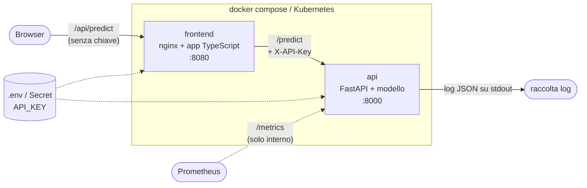

# Predictive Maintenance Service: presentazione del progetto

> In una frase: un modello che stima la probabilità di guasto di una fresatrice industriale,
> trasformato in un servizio "quasi reale": API, Docker, frontend, test automatici, CI,
> metriche e Kubernetes.

Il documento segue i 5 punti richiesti per il colloquio.

---

## 1. Cosa ho costruito

### Il problema e il modello

- **Dataset:** AI4I 2020 (UCI), 10.000 letture di sensori di una fresatrice, con il 3,4% di guasti (339).
- **Input (6 feature):** tipo/qualità del prodotto (L/M/H), temperatura dell'aria e di processo,
  velocità di rotazione, coppia, usura dell'utensile.
- **Output:** probabilità di guasto e predizione 0/1.
- **Modello:** una pipeline scikit-learn (one-hot del tipo + RandomForest con `class_weight="balanced"`),
  split 80/20 stratificato con seed fisso.
- **Data leakage evitato:** le colonne TWF, HDF, PWF, OSF e RNF indicano *quale* guasto è avvenuto,
  cioè sono la risposta stessa. Uso una **whitelist** di feature, quindi non possono entrare nel
  modello, e c'è un test che lo verifica.
- **Metriche sulla classe guasto, non l'accuracy:** un modello che dice sempre "nessun guasto"
  avrebbe il 96,6% di accuracy e sarebbe inutile.

| Precision | Recall | F1 | PR-AUC | PR-AUC casuale |
|---|---|---|---|---|
| 0.71 | 0.66 | 0.69 | 0.76 | 0.034 |

Sul test set il modello trova 45 guasti su 68 e ne perde 23, con 18 falsi allarmi su 2000 macchine.

### Architettura



| Componente | Cosa fa |
|---|---|
| **Training** (`scripts/train.py`) | addestra il modello e salva `model.joblib` + `metadata.json` (versione, metriche, feature, soglia) |
| **API** (FastAPI) | `/predict` con validazione e API key; `/health`, `/ready`, `/version`, `/metrics` |
| **Frontend** (TypeScript + nginx) | form "Machine Health Console"; nginx inoltra `/api` all'API **aggiungendo la chiave lato server**, quindi il browser non la vede mai |
| **Docker** | un'immagine per componente, multi-stage, utente non root, healthcheck |
| **CI** (GitHub Actions) | lint, test, quality gate sul modello, test end-to-end, pubblicazione dell'immagine su GHCR |
| **Kubernetes** (kind) | 2 repliche dell'API, probe, ConfigMap e Secret, autoscaling |

### Il percorso di una richiesta

1. Il browser chiama `/api/predict` senza chiave.
2. nginx aggiunge `X-API-Key` e un `X-Request-ID`, poi inoltra all'API.
3. Il middleware assegna il request id, che comparirà in tutti i log di quella richiesta.
4. API key sbagliata → **401**; input fuori range o con campi sbagliati → **422**; modello non caricato → **503**.
5. Il modello calcola la probabilità e applica la soglia letta da `metadata.json`.
6. Vengono scritti il log della predizione e l'access log (JSON) e aggiornate le metriche. Se arriva un errore imprevisto il client riceve un **500 generico**, mentre lo stack trace resta nei log.

### Configurazione e segreti

Tutta la configurazione arriva da **variabili d'ambiente** (`pydantic-settings`):
- in locale da `.env`, che non è in Git
- in CI da una chiave casuale generata nel job
- in Kubernetes da ConfigMap e Secret

`API_KEY` è obbligatoria (senza, l'app non parte) ed è un `SecretStr`, quindi non finisce mai nei log.

### Come ho lavorato con Git

Una fase per branch, ognuna chiusa da una pull request, con messaggi Conventional Commits
(`feat:`, `test:`, `ci:`, `docs:`, `fix:`). Ci sono 9 PR: modello, API, frontend+Docker, test,
CI, una dimostrazione di CI rossa, il suo revert, osservabilità e Kubernetes. Ci sono i tag
`v0.1.0` (API containerizzata) e `v0.2.0` (CI).

### Demo dal vivo

```powershell
docker compose up --build             # poi apri http://localhost:8080 e fai una predizione
# F12 → Network: la richiesta a /api/predict NON contiene la API key
curl.exe -X POST http://localhost:8000/predict -H "Content-Type: application/json" -d "{}"   # 401
curl.exe http://localhost:8000/metrics                                                     # metriche
python scripts/run_e2e.py             # 11 test end-to-end contro lo stack vero
pytest                                # 58 test unitari, API e quality gate
```

---

## 2. Cosa non conoscevo: Kubernetes e osservabilità

### Kubernetes

**Cosa ho imparato:**
- **Deployment** dice "voglio 2 copie di questo container sempre attive": se un pod muore,
  ne crea un altro. L'ho provato cancellando un pod a mano.
- **Service** dà un nome DNS stabile (`api`) davanti a pod che nascono e muoiono, ed è grazie
  a lui che nginx trova l'API.
- **ConfigMap e Secret** separano la configurazione dall'immagine. La stessa immagine gira
  ovunque e cambia solo l'ambiente.
- **Le 3 probe hanno scopi diversi:**
  - *startup* dà tempo al modello di caricarsi
  - *liveness* riavvia il container se si blocca
  - *readiness* manda traffico al pod solo quando il modello è pronto

  Per questo l'API, se il modello non si carica, resta viva ma "non pronta": così non finisce
  in un loop di riavvii.
- **Rolling update e rollback:** con un'immagine sbagliata il nuovo pod non parte, ma i vecchi
  continuano a servire. `kubectl rollout undo` torna alla versione precedente.
- **HPA:** scala sulla CPU, ma ha bisogno di metrics-server, che kind non installa
  (senza, l'HPA mostra `cpu: <unknown>`).

**Come ho cercato le informazioni:**
- ho chiesto all'AI di spiegarmi ogni oggetto prima di applicarlo
- ho verificato con `kubectl apply --dry-run=server` prima di applicare
- ho usato `kubectl describe` e `kubectl get events` per leggere gli errori veri
- ho provato apposta i casi negativi: un pod cancellato, un'immagine inesistente
- *[aggiungi con parole tue: documentazione ufficiale, video o altro che hai consultato]*

### Osservabilità

**Cosa ho imparato:**
- **Log e metriche servono a cose diverse.** Le metriche dicono *che* qualcosa non va
  (latenza, errori). I log dicono *quale* richiesta e *perché*. Il `request_id` collega le due cose.
- **Log strutturati in JSON**, così uno strumento di raccolta può filtrarli per campo,
  per esempio tutti i 500 o tutte le richieste con un certo id.
- **I tipi di metrica Prometheus:**
  - *counter*: richieste, predizioni
  - *gauge*: modello caricato sì/no
  - *histogram*: latenze, distribuzione delle probabilità
- **Cardinalità:** se uso l'URL come etichetta, chiunque può creare infinite serie chiamando
  URL casuali. Per questo uso il template della route, e gli URL sconosciuti diventano tutti
  `unmatched`.
- **Monitorare un modello ML è diverso dal monitorare un'API.** Oltre a latenza ed errori
  servono:
  - la **distribuzione delle predizioni**: se il 15% risulta "guasto" contro il 3,4% del
    training, qualcosa è cambiato
  - il **drift degli input**: la coppia media nel training è 40 Nm, quindi una media
    stabilmente fuori da 30–50 Nm è un segnale
- **`/metrics` non deve essere pubblico.** nginx lo blocca, e un test end-to-end lo verifica.

**Come ho cercato le informazioni:**
- ho chiesto all'AI quali metriche hanno senso per un servizio ML
- ho verificato i numeri sul dataset, per esempio media e deviazione standard della coppia,
  prima di usarli come soglie di alert
- ho controllato le metriche con `curl /metrics` dopo qualche predizione
- *[aggiungi con parole tue]*

Il dettaglio è in `docs/MONITORING.md` (metriche e alert in PromQL) e in `docs/KUBERNETES.md`.

---

## 3. Come ho usato l'AI

### Il metodo

- **Ho deciso io l'architettura e il piano.** Ho scritto una scaletta in 10 fasi, dal modello
  a Kubernetes, e un file `AGENTS.md` con le regole per l'agente:
  - lavora solo sulla fase richiesta
  - non fa mai commit né push
  - chiede prima di installare dipendenze
  - niente segreti nel codice
  - se c'è una scelta importante, propone 2 opzioni e aspetta
- **L'AI ha generato gran parte del codice e dei test**, sotto le mie direttive.
- **Io rivedevo ogni diff,** eseguivo i controlli (test, lint, build, prove a mano) e facevo i
  commit e le PR.
- **Le scelte sono state mie,** con l'AI che proponeva le opzioni:

| Scelta | Opzioni | Cosa ho deciso e perché |
|---|---|---|
| Modello nel repo | committarlo in Git / generarlo in CI | in Git: semplice, ma lo segnalo come limite |
| API key e browser | nginx aggiunge la chiave / login vero | nginx: semplice, limite dichiarato |
| Metriche | `prometheus-client` a mano / instrumentator automatico | a mano: le capisco tutte, una dipendenza in meno |
| Scope | Grafana, dashboard e generatore di traffico proposti dall'AI | **fermati**: non richiesti, ho tenuto solo `/metrics` e la documentazione |
| Cloud | EC2 / solo documentazione | saltato: non richiesto dalla traccia |

### Esempi concreti (richiesta → proposta → verifica)

**1. Generare i test, e verificare che servano davvero.**
- *Richiesta:* test per il preprocessing, l'API, il logging, più un quality gate sul modello.
- *Proposta:* tra gli altri, un test che verifica che le colonne di leakage non entrino mai
  nelle feature, e un gate che fallisce se il recall scende sotto 0.60.
- *Verifica:* ho **rotto il codice apposta** per vedere fallire i test:
  - ho portato la soglia di decisione a 0.9 → il quality gate è fallito, sia in locale sia in CI
  - ho cambiato la selezione delle feature → il test sul leakage è fallito

  Un test che non fallisce mai non protegge niente.

**2. Il codice generato non è automaticamente corretto.**
- *Proposta:* dipendenze FastAPI scritte come valori di default (`Depends()`).
- *Verifica:* il linter (ruff, regola B008) l'ha segnalato. L'abbiamo riscritto con
  `Annotated`, lo stile raccomandato dalla documentazione attuale.

**3. L'AI non conosce le versioni più recenti delle librerie.**
- Facendo girare i test con i warning visibili è emerso che la nuova starlette depreca `httpx`
  per il `TestClient`, cosa che l'AI non sapeva.
- Le versioni delle immagini Docker e delle GitHub Actions le ho fatte **verificare sulle fonti
  ufficiali** (Docker Hub, release su GitHub) invece di fidarmi della memoria dell'AI.

**4. "Fatto" non significa fatto.**
- L'AI aveva detto di aver convertito il README in UTF-8. Rivedendo il repo ho notato che Git
  lo mostrava come file binario: era ancora UTF-16.
- Da lì in poi ho chiesto di verificare ogni affermazione con un comando, non con una frase.

Il log completo con 28 voci è in `docs/AI_LOG.md`.

---

## 4. Dove mi sono bloccato: i pod Kubernetes non partivano

**Cosa è successo.** Ho applicato i manifest al cluster kind. Tutti i pod sono rimasti in
`ImagePullBackOff`, e l'API non è mai partita.

**Cosa ho guardato.**
```powershell
kubectl get pods -n pm-service          # STATUS: ImagePullBackOff
kubectl get events -n pm-service        # il messaggio vero
```
```text
Failed to pull image "pm-service-api:0.1.0": failed to resolve reference
"docker.io/library/pm-service-api:0.1.0": pull access denied, repository does not exist
```

**Il ragionamento.** L'immagine esisteva: `docker image ls` la mostrava. Però Kubernetes la
cercava su **Docker Hub** (`docker.io/library/...`). Quindi il cluster non vedeva le immagini
del mio Docker locale.

**La causa.** kind fa girare Kubernetes *dentro* un container, e quel container ha un suo
archivio di immagini, separato da quello del Docker sul mio PC.

**La soluzione.**
```powershell
kind load docker-image pm-service-api:0.1.0 pm-service-frontend:0.1.0 --name pm-service
kubectl rollout restart deployment -n pm-service
```
Dopo pochi secondi i pod sono diventati `1/1 Running`.

**Cosa ho imparato:**
- Il messaggio d'errore conteneva già la risposta (`docker.io/library/...`): bisogna leggere
  gli eventi del pod, non solo lo stato.
- In un cluster vero le immagini non si caricano a mano: vengono da un **registry**. La CI le
  pubblica già su GHCR, quindi in produzione il Deployment userebbe
  `ghcr.io/.../pm-service-api:<sha>`.

**Altri problemi reali, se chiedono altro** (tutti in `docs/PROBLEMS.md`):
- **Una PR con la CI rossa è stata mergiata.** Mancava la branch protection su `main`. La
  pipeline però ha impedito la pubblicazione dell'immagine rotta. L'ho risolto con un revert in
  una PR e spostando il tag.
- **I log JSON non comparivano nei test.** La prima ipotesi era sbagliata. La causa vera: un
  handler di logging agganciato a uno stdout già chiuso da pytest.

---

## 5. Cosa non mi convince

### La qualità del modello
- **Recall 0.66 significa che perdo 1 guasto su 3.** In manutenzione predittiva un guasto non
  visto costa molto più di un falso allarme.
- **La soglia 0.5 non è stata tarata.** Andrebbe scelta dalla curva precision-recall, partendo
  dal costo reale di un guasto mancato rispetto a un'ispezione inutile.
- **In produzione non so se il modello ha ragione.** La verità (la macchina si è rotta
  davvero?) arriva giorni dopo. Servirebbe collegare le predizioni ai registri di manutenzione
  e misurare il recall nel tempo.
- **Il drift è controllato su una sola feature, e solo sulla media.** Approfondirei metriche
  come la PSI su tutte le feature.

### La sicurezza
- **Una sola API key statica,** condivisa tra nginx e l'API, senza rotazione e senza sapere
  *chi* sta chiamando.
- **Il frontend è aperto:** chiunque lo raggiunga può fare predizioni. Servirebbe un login vero
  (OAuth2/OIDC).
- **Mancano HTTPS e rate limiting.**
- **I Secret di Kubernetes sono solo in base64,** non cifrati. Userei un secret manager
  (Vault, AWS Secrets Manager) con External Secrets.
- **Il modello è un file pickle (`joblib`):** se qualcuno lo sostituisce, al caricamento può
  eseguire codice. Deve arrivare da una fonte controllata.

### Il ciclo di vita del modello
- **Il modello (7,5 MB) è committato in Git.** Ogni retraining appesantisce per sempre la
  storia del repo. Servirebbe un **model registry** (es. MLflow).
- **Non c'è retraining automatico:** è uno script manuale, e il test set del quality gate va
  riesportato a mano.
- **I dati di training non sono versionati** (es. DVC), quindi non posso ricostruire
  esattamente con quali dati è stato addestrato un modello.

**Cosa approfondirei per primo:** il model registry con retraining in CI. Il nuovo modello
viene addestrato, confrontato con quello attuale sul quality gate, e promosso solo se è migliore.

L'elenco completo è in `docs/PRODUCTION_GAPS.md`.

---

## Preparazione alle modifiche dal vivo

| Richiesta probabile | Dove intervenire |
|---|---|
| Aggiungere un campo di input | `preprocessing.py` (`FEATURES`), `api/schemas.py` (`PredictRequest`), retraining, `frontend/index.html` + `src/api.ts`, test |
| Aggiungere un endpoint (es. `/predict/batch`) | `api/schemas.py` (lista di richieste), `api/routes.py`, `tests/test_api_predict.py` |
| Cambiare la soglia di decisione | `models/metadata.json` (`decision_threshold`); il quality gate dirà se il recall regge |
| Cambiare una configurazione su Kubernetes | `kubectl edit configmap api-config -n pm-service`, poi `kubectl rollout restart deployment/api -n pm-service` |
| Scalare, rollout, rollback | `kubectl scale`, `kubectl set image`, `kubectl rollout undo` (vedi `docs/KUBERNETES.md`) |
| Un test che fallisce in CI | GitHub → Actions → job rosso → log; riprodurlo in locale con lo stesso comando (`pytest`, `ruff check .`) |
